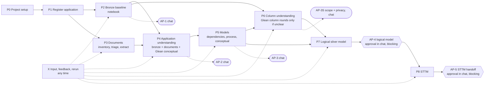
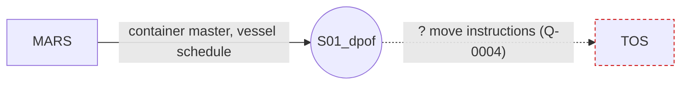
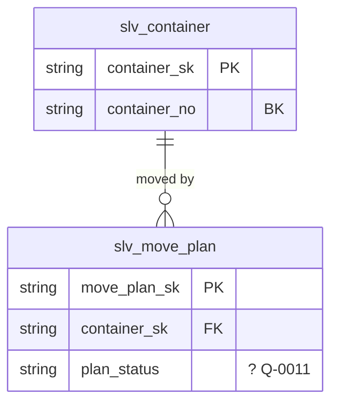
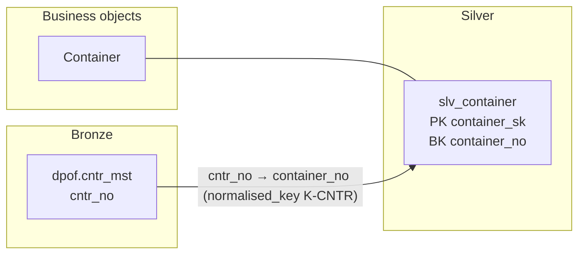
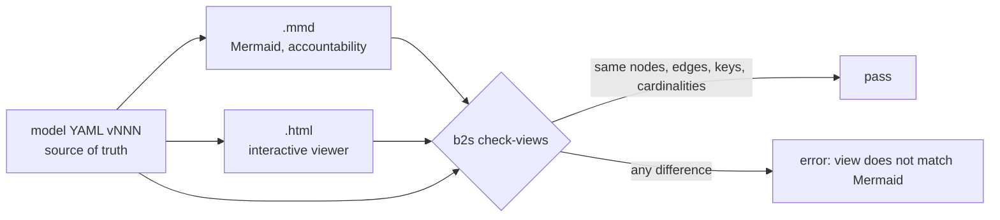

# Bronze-to-Silver V1.4 — design specification

| | |
|---|---|
| Status | **Draft for owner review** |
| Date | 2026-11-13 |
| Scope | Team 1 only: from bronze tables and documents of one application to an approved source-to-target mapping (STTM) |
| Inputs | Requirements RQ-01 to RQ-09 and quiz answers QA-01 to QA-17 in [`V1_3_REVIEW_WORKING.md`](V1_3_REVIEW_WORKING.md) §7A; review items R, F, DC, DB in the same file |
| Base code | V1.1 (public 2.4.0) was replaced in this repository by the V1.4 framework (history: commit db4fc1b). Reused parts are listed in §19 |

Items marked **check** are assumptions about the Databricks workspace. Test them before you build on them.
Items marked **decide** need an owner decision. They are collected in §21.

---

## 0. V1.4 keeps the V1.3 sequence (decided, I-15)

V1.4 is an upgrade of what runs **inside** the V1.3 phases, not a new framework. The phase sequence, the checkpoints
and the V1.3 folders stay. The repository is the whole framework, P0–P6 (I-16), and **the agent orchestrates every
step, notebooks included** (`@b2s-run`; `run_by` is recorded in each event). On first use the client's own notebooks
and templates are integrated with `@fw-integrate` (`@p0-setup`). Where later sections of this spec still use the working
names P2–P8 and AP-1–AP-5, read them through this table; the code and skills use the V1.3 names.

| V1.3 phase / checkpoint (kept) | Working name in §5–§12 | What V1.4 upgrades inside it | Code / skill |
|---|---|---|---|
| P0 Setup | P0 | project pin, defaults, write guard, not in `/Workspace/Shared` | `b2s/project.py`, `00_start_here` |
| P1 Register + bronze baseline (S0, S1, S2, S5) | P1, P2 | redaction before write, key limits and removed-by-rule, stable open-point ids, fingerprints, resume | `b2s/baseline/`, `nb_p1_baseline` |
| **CP1** bronze baseline | AP-1 | approved in the chat; a decision per open point | `@x-approve` |
| P2.1 Documents: inventory, triage, extracts | P3 | duplicates, compare, unreadable list, redacted extracts | `b2s/documents.py`, `nb_p2_documents`, `@p2-1-triage` |
| P2.2 Compare with the baseline | (in P4) | `documents/comparison` file: confirms, contradicts, adds | `@p2-2-compare` |
| **P2.2b Application understanding + models (new)** | P4, P5 | bronze + documents + Glean conceptual rounds; app brief; dependencies, process, conceptual models with `?` | `@p2-2b-understand`, `@x-research` |
| P2.3 Scope proposal | P6 | column understanding (known / inferred / unclear), scope and privacy proposal, worker decisions kept | `b2s/columns.py`, `@p2-3-scope` |
| P2.4 Questions and assumptions | (items) | never block before the STTM | items `Q-`, `A-` |
| **CP2** documents, application understanding, scope | AP-2, AP-3, AP-3S | one checkpoint in the chat; nothing left in `review`; privacy handling set | `@x-approve` |
| P3 Joins + central model | P7 | S3 joins as in V1.3; the central model is the **logical silver model** (YAML → Mermaid → viewer) | `b2s/columns.py` (draft), `@p3-logical` |
| **CP3** central model (CP3b as in V1.3) | AP-4 | **required before P4** (I-11) | `@x-approve` |
| P4 STTM: P4.1 slot, P4.2 validate, P4.3 review, P4.4 export | P8 | canonical STTM drafted from the approved model, validator, export plug-in, mapping model | `b2s/sttm.py`, `plugins/`, `@p4-sttm` |
| **CP4** STTM (CP4b as in V1.3) → H1 | AP-5 | decisions per open question / assumption; handoff with self-approval statement | `@x-approve`, `b2s/handoff.py` |
| P5 Build: P5.1 codegen, P5.2 QA, P5.3 code review, P5.4 masters → **CP5 (automatic)** | — | ported from 2.4.0 onto the canonical STTM; versioned notebooks; QA on dev silver | `b2s/build/`, `nb_p5_qa`, `@p5-*` |
| P6.1 Release → **CP6 (automatic)** → H2 | — | readiness package for deployment | `b2s/release.py`, `@p6-1-release` |

Folders per application (V1.3 names): `inbox/`, `uploads/`, `work/P1…P4/`, `review/approvals/`, `state/items/`,
`handoff/`. Approval statement: `I, <name>, approve CP3 logical.v004.` Plug-in activation: `approve PLUGIN <name>.vX`.
Port guide for moving each module into the V1.3 code: [`V1_4_PORT_GUIDE.md`](V1_4_PORT_GUIDE.md).

---

## 1. Purpose

Team 1 receives the backend tables of an application (about 30 applications in total) and its documents.
Team 1 must find out what the application does for the business, model it, and deliver an STTM to team 2.

The people who run the work, and often the client, do not know everything at the start.
V1.4 lets the work move forward with what is known, records what is not known, and goes back when new input arrives.

## 2. Principles

1. **Move forward, mark what you do not know.** Each model element, mapping and claim has a status: `known`, `assumed`, or `unknown` (shown as **?**). Nothing blocks before the STTM handoff approval (AP-5).
2. **Explicit approvals in the chat, at fixed points.** At each approval point Genie asks the worker, in the chat, to approve a named version of named files. The worker replies with an explicit statement that carries their name. Genie records the statement word for word. The worker never edits a file to approve. Two points block: the logical silver model (AP-4) before the STTM starts, and the STTM (AP-5) before the handoff. One person, no maker-checker (I-09): the safeguard is transparency to team 2.
3. **Understand the application before the columns.** Bronze, documents and Glean are used together. Glean gets conceptual questions first. The framework asks about specific columns only after it has integrated the conceptual answers and still cannot explain a column.
4. **Code for facts, agents for judgement, people for decisions.** Heavy work runs in notebooks that a person runs. Genie Code reads short summaries and writes drafts.
5. **Files are the state, and they must be safe.** No tables are available for state (RQ-01). Each item is its own file, each change is an event, and each output records the versions of its inputs.
5a. **The version is in the file name.** A rerun, feedback or new input that changes a file writes a new version (`logical.v004.yaml`). Old versions are never overwritten. An approval names exact versions, so a newer version is visibly not approved (§7.5).
6. **Everything can go stale, nothing goes silently wrong.** Each output has a fingerprint. A changed input, configuration or framework version marks the dependent outputs stale. The navigator plans a targeted rerun.
7. **Personal data never reaches a file.** Values are redacted before any write. Only shapes and ratios are kept for sensitive columns.
8. **The framework is read-only for workers.** Local extensions are project plug-ins. Maintainers move good plug-ins into core.

## 3. Two areas: framework and project

| | Framework | Project folder |
|---|---|---|
| What | Code, notebooks, skills, rules, schemas, templates, core plug-ins | All work of one project: applications, items, models, STTMs, events, reports, project plug-ins |
| Where | Git (core repository). Workers download a release into their workspace | A workspace folder, **not** in `/Workspace/Shared` (R-01, DB-12) |
| Who changes it | Maintainers only (owner and a small group) | Workers (operators, experts) through framework tools |
| Version | Semantic version, `FRAMEWORK_VERSION` file, `MANIFEST.json` with the hash of each file | `project.yaml` pins the framework version |
| History | Git | Event files and snapshots (§7) |

**Local edit detection.** At start, each tool compares the framework files with `MANIFEST.json`. A changed core file gives a warning on every page and an event `framework_modified`. Workers extend through project plug-ins (§15), not by editing core files.

## 4. Roles

**One application is typically worked by one person, the worker. There is no maker-checker** (I-09).
The two team-1 responsibilities (RQ-06) are hats the worker wears, not separate people. The framework uses them to organise the work, not to split permissions.

| Who / hat | Does | Must not |
|---|---|---|
| **Worker — modelling hat** (expert work) | Forms the mental model of the application; shapes the dependencies, process, conceptual and logical models; decides open questions; gives approvals in the chat | — |
| **Worker — analysis hat** (analyst work) | Runs notebooks, registers documents, answers clarify steps, probes corner cases, completes the STTM | — |
| **Genie Code** | Reads summaries, drafts application understanding, models and STTM, writes Glean requests, parses replies, proposes questions; **asks for approvals and records the worker's statement word for word** | Run heavy compute; write, complete or rephrase an approval statement; treat "looks good" or silence as approval; set an item to `verified` |
| **Team 2** | Receives the handoff package; the first other person who sees the work | — |
| **Maintainer** | Integrates contribution packages, releases framework versions | — |

**Limit (R-02).** Genie Code runs with the user's own permissions and records the approval itself. No technical control can prove that a statement in the chat was typed by the worker. V1.4 accepts this and reduces the risk in three ways (§12):
1. **Explicit statements.** An approval needs the worker's name, the word "approve", the approval point and the main file version (`I, Jane Doe, approve AP-4 logical.v004.`). Genie shows this template, pre-filled, in the chat. The request behind it holds the exact file versions, and the tool refuses if a file changed after the request was shown.
2. **Transparency to team 2.** The handoff states that it is self-approved, quotes each approval statement, and lists every assumption, every open question with its decision, and every item created `via: genie` that the worker did not touch afterwards.
3. **Audit.** Each approval is an event with `how: chat`, the verbatim statement, the workspace user, and the exact file versions. **check (K-07):** whether workspace audit logs can link the event to the chat session.

---

## 5. Process

The steps form a dependency graph, not a strict line. A step can run when its inputs exist. Its output is a draft until the worker approves it at an approval point (§12).



AP-4 blocks the start of P8. AP-5 blocks the handoff. The other points do not block work (§12).

### 5.1 Step table

| Step | Name | Runs as | Main inputs | Main outputs | Mermaid |
|---|---|---|---|---|---|
| P0 | Project setup (once) | notebook `00_project` | framework release | `project.yaml`, `_project/` ontology copy, access check (§14) | — |
| P1 | Register application | notebook `00_start_here` | app id, schemas, lookup schemas | `apps/<app>/app.yaml` | — |
| P2 | Bronze baseline | notebook `nb_p2_baseline` (person runs; resumable) | schemas | `baseline/` parts + `summary.vNNN.json`; open points `OP-*` | — |
| P3 | Documents | notebook `nb_p3_documents` + skill `@p3-triage` | `inbox/` | document inventory, triage, extracts, document claims (evidence) | — |
| P4 | Application understanding | skill `@p4-understand` + Glean conceptual rounds | baseline summary, document extracts, Glean replies | `understanding/app_brief.vNNN.md`, evidence, questions | — |
| P5 | Models | skill `@p5-model` | P4 outputs, ontology | `models/dependencies.vNNN.yaml`, `process.vNNN.yaml`, `conceptual.vNNN.yaml` | flowchart, flowchart, flowchart (§9) |
| P6 | Column understanding | tool `x_columns` + skill `@p6-columns` + Glean column rounds | baseline, models, document claims | `columns/<table>.vNNN.yaml` (meaning, status per column) | — |
| P7 | Logical silver model | skill `@p7-logical` | conceptual model, column understanding, keys | `models/logical.vNNN.yaml` | erDiagram |
| P8 | STTM | skill `@p8-sttm` + validator + template adapter | **latest approved** logical model version (AP-4), columns, evidence | `sttm/sttm.vNNN.json` (canonical) + template exports + mapping model | flowchart (§9.5) |
| AP-5 | STTM handoff | chat: Genie runs `x_approve`; worker approves in the chat | approval request | approval item, handoff package | — |
| X | Input and rerun | notebook `00_start_here`, skill `@x-input` | typed instruction, feedback, uploaded file | input item, routing, stale marks, rerun plan | — |

### 5.2 Why P2 and P3 run side by side

Bronze shows the structure. Documents (PDF, Word, PowerPoint) show workflows and flowcharts. P4 needs both (QA-03).
P2 does not wait for documents. P3 does not wait for bronze. P4 starts when either is available and improves when the other arrives.

### 5.3 What "never blocked" means

- A step never refuses to run because a question is open. It uses the current best answer as an **assumption** and marks the output element `assumed`.
- A step refuses to run only when an input file is missing or invalid (for example no baseline summary exists), or when it needs an approved input: **P8 STTM starts only from an approved logical model version (AP-4)** (I-11).
- AP-5 (STTM handoff) is the only place where open questions must be decided (§12).

---

## 6. Knowledge items

All knowledge is a set of small items. Each item version is one JSON file (`items/evidence/E-0031.v002.json`, §7.5). Readable views (Excel, HTML, Markdown) are generated from the items and are never edited.

| Kind | Prefix | Id type | Example | Created by |
|---|---|---|---|---|
| Evidence (one claim) | `E-` | sequential | `E-0031` | tools, Genie, operator |
| Question | `Q-` | sequential | `Q-0012` | Genie, operator, expert |
| Assumption | `A-` | sequential | `A-0007` | Genie, operator |
| Open point (from baseline) | `OP-` | stable hash | `OP-3f9a2c` | P2 notebook |
| Input (instruction, feedback, file) | `IN-` | sequential | `IN-0004` | operator, expert |
| Glean round | `GR-` | sequential | `GR-0003` | P4, P6 |
| Approval request | `AR-` | sequential | `AR-0005` | `x_approve request` (Genie) |
| Approval | `APR-` | sequential | `APR-0004` | `x_approve record`, from the worker's chat statement |

`AP-1` to `AP-5` are the names of the approval **points** (§12.1), not item ids.
| Change request (ontology) | `CR-` | sequential | `CR-0001` | Genie, operator |
| Document | `IF-` | sequential | `IF-0043` | P3 |

**Ids (DC-03, DC-09).** Items that code derives again on each run (open points, column findings) get a **stable hash id** from their identity: kind + tables + columns. A second **content hash** covers the details and is used for staleness. Items that a person or agent creates get a **sequential id** from the id allocator (§7.3). An id is never reused.

### 6.1 Common fields

```json
{
  "id": "E-0031",
  "kind": "evidence",
  "app": "S01_dpof",
  "statement": "One row of PUB_MSCHD is one scheduled move of one container.",
  "about": [{"type": "table", "ref": "dpof.pub_mschd"}],
  "status": "unverified",
  "confidence": "medium",
  "origin": {"type": "document", "ref": "IF-0021", "location": "p. 12"},
  "root_source": "IF-0021",
  "authority": 3,
  "created": {"at": "2026-11-13T09:40:00Z", "by": "user@example.com", "via": "genie", "event": "EV-..."},
  "history": ["EV-...", "EV-..."],
  "content_hash": "sha256:..."
}
```

- **`root_source` (DC-05).** The first origin of a fact. A Glean reply that summarises IF-0021 has root source IF-0021. Only evidence with **different root sources** counts as corroboration.
- **`authority` (DC-13).** Reuses the numeric scale of V1.1 (`information.yaml`, 1 = strongest). New document authority classes: `client_truth`, `proposed`, `team`. A `proposed` document alone never corroborates.
- **`via`.** `genie`, `notebook`, `tool`, or `manual`. Shown on each approval page and in the handoff (DC-18).

### 6.2 Status values

| Item | Status values |
|---|---|
| Evidence | `unverified`, `corroborated`, `confirmed_by_bronze`, `contradicted`, `superseded` |
| Question | `open`, `answered`, `assumed` (an assumption stands in), `withdrawn`; at AP-5: `accept_assumption` or `must_answer` |
| Assumption | `active`, `confirmed` (became evidence), `rejected` |
| Model element, column, mapping | `known`, `assumed`, `unknown` |

A model element with status `assumed` names its assumption (`A-`). A model element with status `unknown` names its question (`Q-`). This rule is checked by code.

---

## 7. File state and audit (no tables)

Workspace files have no transactions and no row locks (I-05). V1.4 makes files safe by design.

### 7.1 Rules

1. **One item, one file per version.** No tool rewrites a large shared file to change one item.
2. **Versioned file names, write-once** (§7.5). A changed output is a new file. No version file is ever overwritten.
3. **Every change is an event.** An event is one new file in `events/`. Events are never changed or deleted.
4. **Write to a temporary name, then rename.** A reader never sees a half-written file. **check:** rename is atomic on `/Workspace` files.
5. **Every output version has a sidecar** `<name>.vNNN.meta.json` with its fingerprint (§8), the exact input versions it was made from, the reason for the new version, the event that wrote it, and the framework version.
6. **Readable views are generated.** `*.xlsx`, `*.html`, `*.md` views have a header "Generated — do not edit" and name the versions they show.
7. **Snapshots are manifests.** A snapshot is one file `snapshots/SN-0003.json` that lists file versions and hashes. Because versions are write-once, nothing needs to be copied.

### 7.2 Event file

```json
{
  "id": "EV-20261113T094001Z-7f3a",
  "at": "2026-11-13T09:40:01Z",
  "user": "user@example.com",
  "via": "notebook",
  "notebook_run": "<run id or 'interactive'>",
  "framework_version": "1.4.0",
  "app": "S01_dpof",
  "action": "item_created",
  "step": "P4",
  "items": ["E-0031"],
  "outputs": {"understanding/app_brief.md": "sha256:..."},
  "note": "..."
}
```

`user` comes from `current_user()` in a notebook, or from the workspace user in Genie. It is not typed.

### 7.3 Id allocator and concurrency

- Sequential ids come from `state/ids/<prefix>.next` through a lock file (DC-09). **check:** exclusive file creation (`O_EXCL`) works on `/Workspace`.
- **Fallback if it does not work:** an application **lease**. `state/lease.json` names the user and an expiry (default 2 hours). Tools that write to the application refuse to run under someone else's valid lease. The lease is renewed on each write and released at session end.
- The concurrency test starts parallel processes that force contention. Twenty serial runs are not enough (DC-09).

### 7.4 Audit

- Who did what, when, and how (Genie, notebook, manual) comes from `events/`.
- What an output was made from comes from its sidecar.
- What was approved comes from the approval item: exact file versions, their hashes, and the verbatim statement.
- **Limit.** Anyone with write access can change files. The design is **tamper-evident, not tamper-proof**: each approval records the hash of every file version it covers, so a later change shows as a mismatch.

### 7.5 Versioning through file names

| Rule | Detail |
|---|---|
| Name | `<name>.v<NNN>.<ext>`, three digits, from `v001`. Example: `models/logical.v004.yaml`, with `logical.v004.mmd` and `logical.v004.meta.json` beside it |
| Items | `items/<kind>/<id>.v<NNN>.json`, for example `items/questions/Q-0012.v003.json` |
| When a new version is written | Only when the content hash differs from the latest version. A rerun that produces the same content writes no new version, only an event |
| Latest | The highest version number. There is no "latest" pointer file to keep in step |
| Number allocation | Under the same lock or lease as ids (§7.3), so two writers cannot take the same number |
| Reason | The sidecar states why: `first`, `rerun`, `input IN-0004`, `answer Q-0012`, `upgrade 1.4.1`, `manual edit by worker` |
| Lineage | The sidecar lists the input versions: `{"models/conceptual": "v003", "columns/pub_mschd": "v002"}`. The navigator follows these to find stale outputs |
| Diff | `b2s diff <name> v003 v004` gives a short change summary that Genie shows in the chat, for example before asking for a new approval |
| Worker edits | A worker who edits a file by hand saves it as a new version through `b2s save <file>`; a direct edit of a version file is detected by its hash and reported |
| Not versioned | Events (already write-once), raw Glean replies (write-once), generated views (always rebuilt from the latest or from a named snapshot) |
| Retention | All versions are kept. An `archive` action can move old, unapproved versions to `archive/` later; approved versions are never moved |

---

## 8. Fingerprints, staleness and rerun

### 8.1 Fingerprint of an output

```
fingerprint = hash(
  step id + step code version,
  framework version,
  effective configuration used by the step (limits, patterns, abbreviations),
  content hash of each input item or file,
  for bronze: per base table the Delta version, plus the view text of each view on the path
)
```

This covers DC-12 (engine version, configuration) and DB-07 (base tables and view text). A view over views resolves down to all base tables.

### 8.2 Staleness

`x_navigator` computes the current fingerprint of each output and compares it with the sidecar of its latest version. A different value marks the output **stale**. An output whose sidecar names an input version older than that input's latest version is **stale (upstream)**.

### 8.3 Rerun

- The navigator shows the rerun plan: the steps to run, in order, and why.
- A notebook step reruns only stale tables or items. It does not recompute everything.
- `fresh_run` is a one-run flag with default `no`. The runner clears it at the end, and the event records the reason (DC-07).
- A rerun that changes an output writes a new version. An approval of `v003` does not cover `v004`: the navigator and the app page show "approved v003, latest v004 not approved", with the diff. The old approval stays in the history.

### 8.4 Input at any time (RQ-04)

`00_start_here` → action `give-input` (typed text, or a file in `uploads/`) creates an `IN-` item. `@x-input`:
1. Traces the input against the three ontology layers (V1.1 `x_input_ontology`).
2. Proposes a route: the steps that must use it.
3. Asks at most 5 short clarify questions, only about what the trace could not settle.
4. Marks the routed outputs stale.

Possible routes include "add a schema", "add a profile for these tables", "rerun P4 with this document", "change this model element".

---

## 9. Models and Mermaid

Each model is a YAML file and the source of truth. Mermaid is generated from it. Each element has `status` and its links to evidence, assumptions and questions.

Mermaid style for all diagrams:

| Status | Style |
|---|---|
| `known` | solid line, normal fill |
| `assumed` | dashed line, label ends with `(A-0007)` |
| `unknown` | dashed red line, label starts with `?` |

### 9.1 App dependencies (QA-14)

Direct upstream and downstream systems of this application only. Mermaid `flowchart LR`.

```yaml
# models/dependencies.yaml
app: S01_dpof
systems:
  - {id: MARS, name: "MARS", relation: upstream, gives: ["container master", "vessel schedule"], status: known, evidence: [E-0012]}
  - {id: TOS, name: "Terminal operating system", relation: downstream, gives: ["move instructions"], status: unknown, question: Q-0004}
```



### 9.2 Process model

What work happens in the application, the steps and events, and which tables record them. Mermaid `flowchart TD`. Each step links to the business process in `business.yaml` (`P-LOGI-01`, ...) and to the tables that record it.

```yaml
# models/process.yaml
processes:
  - id: PR-01
    business_process: P-LOGI-01
    name: Plan container move
    steps:
      - {id: ST-01, name: "Create move plan", records: [dpof.pub_mschd], status: known, evidence: [E-0031]}
      - {id: ST-02, name: "Approve plan", records: [], status: unknown, question: Q-0009}
    flows: [{from: ST-01, to: ST-02, status: assumed, assumption: A-0003}]
```

### 9.3 Conceptual model

Business objects from the ontology that this application uses, and their relationships. Mermaid `flowchart LR`, not `erDiagram`: the conceptual level has no keys, and flowchart styles can show status. New objects or relationships are **change requests** (`CR-`), never silent edits to the ontology.

```yaml
# models/conceptual.yaml
objects:
  - {name: Container, ontology: business.Container, status: known, tables: [dpof.cntr_mst]}
  - {name: MovePlan, ontology: null, status: assumed, assumption: A-0005, change_request: CR-0002}
relationships:
  - {from: MovePlan, to: Container, verb: "moves", cardinality: "N:1", ontology: business.rel.LOGI-03, status: known}
```

### 9.4 Logical silver model

Silver tables, grain, data class, load pattern, keys and foreign keys. Mermaid `erDiagram`. A key or foreign key that is not `known` shows `?` in the attribute comment.



The logical model is the direct input to the STTM. Its format is fixed by `schemas/logical_model.schema.json` (DC-16).

### 9.5 Mapping model

The connections from bronze to silver: which bronze tables and id columns feed which silver table and key. Generated from the column understanding and, once it exists, the STTM. Mermaid `flowchart LR`, with three column groups: business objects, silver tables (with PK, BK, FK), bronze tables (with the id columns used).



### 9.6 Model viewer: interactive HTML that matches the Mermaid (`@x-model-view`)

**Purpose.** Mermaid is the accountability record of each model. People also need a page where they can see the entities, tables, ids and cardinalities clearly, click through the connections, and read the text. The viewer gives that page **without** becoming a second truth.

**One source, two renderings, one check.**



- The `.mmd` and the `.html` of a model version are both generated from the same YAML version, and carry the same version in their names: `logical.v004.mmd`, `logical.v004.html`.
- The HTML embeds its graph as JSON (`<script type="application/json" id="graph">`). `b2s check-views` parses the `.mmd` (the framework's own Mermaid subset), reads the embedded JSON, loads the YAML, and requires the three to be **identical**: same node ids and labels, same edges, same key columns (PK, BK, FK), same cardinality on each edge, same status (`known`, `assumed`, `unknown`). Any difference is an error, and approval requests refuse to run while it exists.
- The HTML shows the Mermaid notation of each relationship (for example `||--o{`) next to its plain reading ("one container, many move plans"), and has a **Mermaid** tab with the exact `.mmd` source.

**What the viewer shows.**

| View | Nodes | Edges |
|---|---|---|
| Conceptual | business objects | relationships with verb and cardinality |
| Logical | silver tables with PK, BK, FK columns, grain, data class | FK relationships: 1:1, 1:N, N:1, with crow's-foot ends and a text label |
| Mapping | business objects, silver tables, bronze tables with id columns | object ↔ silver table; bronze id column → silver key, with the key rule |
| Process, dependencies | as §9.1, §9.2 | as §9.1, §9.2 |

Interaction: click a node to highlight its connections and show its details (keys, evidence, assumptions, questions); filter by status, by business object, or by bronze schema; search by table or column name; pan and zoom. Unknown items show `?` and a dashed red border; assumed items a dashed border and the `A-` id. Status is never shown by colour alone.

**Layout rules (tested).**
1. **No overlapping boxes.** The layout is computed in Python by a layered (Sugiyama-type) algorithm with fixed column spacing and box sizes measured from the text. The test checks every pair of boxes, and every edge label against every box, for overlap.
2. **Readable text.** Text and box colours come from one palette. The test computes the WCAG contrast ratio of every text/background pair in the light and the dark theme and requires **at least 4.5:1** (7:1 for small key labels).
3. **Large models.** More than 25 tables: group by business object or subject area, collapsed groups expand on click.
4. **No external scripts needed.** The page is one self-contained HTML file with inline SVG, CSS and JS, so it works in the workspace, in a download, and in the handoff package. If the workspace allows it (**check K-08**), the Mermaid tab can also render the diagram with Mermaid's own library; otherwise it shows the source text.

**Where it is used.** Every approval page (§12.2) embeds the viewer of the files in the request. The handoff package includes the viewer for the approved logical model and mapping model.

**Skill `@x-model-view`.** The worker or Genie runs `b2s view <app> [model] [version]`. The skill builds the HTML, runs `b2s check-views`, and reports the link, or the exact differences when the check fails. Genie never edits a generated `.mmd` or `.html` by hand; it changes the YAML (as a new version) and regenerates.

---

## 10. Glean protocol (QA-04, QA-15)

### 10.1 Rounds

| Round type | When | Asks | Example |
|---|---|---|---|
| `conceptual` | P4, first | What the application does, which work happens, how it depends on other systems, its workflows | "What business process does DPOF support, and which systems send it data?" |
| `conceptual_followup` | P4, after a conceptual round is integrated | Gaps the first round left | "What happens after a move plan is approved?" |
| `column` | P6, only for columns still unclear | Meaning of specific columns and relationships | "In PUB_MSCHD, what does STAT_CD = 'H' mean?" |

**Rule enforced by code:** `x_research new --type column` refuses to create a column round for an application until at least one conceptual round has status `integrated`, and only for columns that `x_columns` marks `unclear` after the framework's own attempt (§11).

### 10.2 Files

```
apps/<app>/research/GR-0003/
  request.json        one JSON object per topic, with a budget
  reply.raw.txt       saved first, exactly as received (DC-04)
  reply.json          parsed reply
  round.json          status: drafted | sent | replied | integrated | closed | reopened
```

- `x_research record` refuses to parse until `reply.raw.txt` exists and is not empty. It stores the hash of the raw reply.
- **Two channels.** Genie sends through the Glean connector when the session has it. Otherwise the person pastes the request into Glean and pastes the reply back (paste mode). Both channels write the same files.
- Each claim from a reply becomes evidence with origin `glean`, `root_source` set to the document Glean cites (or `glean:GR-0003` if it cites none), and confidence `medium` at most.
- A closed round can reopen with a reason and an extra budget (C-42).

---

## 11. Column understanding (P6)

For each in-scope table, `x_columns` first tries to explain each column **without** Glean:

1. Name tokens and abbreviations (`information.yaml`, `business.yaml`).
2. Baseline profile: type, empty share, distinct count, length, patterns, column class (V1.1 `classify_column`).
3. Document claims that name the table or column.
4. The conceptual and process models: which object and step the table records.

Each column gets `meaning`, `column_class`, `status` (`known`, `assumed`, `unclear`) and links. Only `unclear` columns, grouped by table and topic, go into a column Glean round. What Glean cannot answer becomes a question or an assumption. The work continues.

---

## 12. Approvals in the chat, and the STTM handoff

The worker approves in the Genie chat, with their name on it. They never edit a file to approve (I-10). The worker approves their own work; there is no maker-checker (I-09).

### 12.1 Approval points

**Per application**

| Point | After | Approves (exact versions) | Decisions asked | Blocks | Status |
|---|---|---|---|---|---|
| AP-1 | P2 Bronze baseline | `baseline/summary.vNNN.json` and its open points | per open point: accept, change, question, defer | no | proposed |
| AP-2 | P4 Application understanding | `understanding/app_brief.vNNN.md`, `models/dependencies.vNNN.yaml` | none required | no | proposed |
| AP-3 | P5 Models | `models/process.vNNN.yaml`, `models/conceptual.vNNN.yaml` | none required | approval of AP-4 (chain) | proposed |
| AP-3S | Scope and privacy (from P2.3 scope proposal and P6) | in/out-of-scope tables and columns, overrides with reason, privacy handling per personal-data column (`keep_tagged`, `mask`, `hash`) | per table/column marked `review`; per personal-data column: handling | approval of AP-4 (chain) | **proposed — new** |
| AP-4 | P7 Logical silver model | `models/logical.vNNN.yaml`, `logical.vNNN.mmd` | none required | **yes — P8 STTM starts only from an approved version** | decided (I-11) |
| AP-5 | P8 STTM | `sttm/sttm.vNNN.json`, its exports, the mapping model, and the list of business-logic columns with their rules | per open question and active assumption: `accept_assumption` or `must_answer` (QA-07); per business-logic rule: confirm | **yes — the handoff** | decided |

**Per project** (they affect more than one application)

| Point | When | Approves | Blocks | Status |
|---|---|---|---|---|
| AP-P1 | A change request to the shared ontology (`_project/business.yaml` etc.) | the exact change: new object, synonym, relationship or rule | applying the change to the shared ontology. Until then the app uses it as `assumed` | **proposed — new** |
| AP-P2 | A new or changed shared master or key rule (`entities.yaml`, `key_normalisation.yaml`), incl. survivorship when two apps feed one master | the entity, its business key, the key rule, survivorship | approval of AP-4 of any app whose logical model uses it (chain) | **proposed — new** |
| AP-P3 | Activating a project plug-in that overrides a core slot | plug-in name, version, slot, contract test result | using the plug-in in runs | **proposed — new** |
| AP-P4 | Applying a framework upgrade to the project | from/to version, the outputs that will become stale | changing the pin | **proposed — new** |

**Chain rule.** An approval covers exact versions, and it can only be given when the versions it rests on are approved. AP-4 for `logical.v004` needs: AP-3 for the conceptual version it was built from, AP-3S for the scope version, and AP-P2 for each shared master it uses. Work never waits for this chain; only the approval does. The approval request lists any missing upstream approval and offers to ask for it first.

- AP-1, AP-2 and AP-3 never stop work. They record what the worker stood behind, and when.
- Genie offers an approval when a point's files are new or changed since the last approval. The worker can say "later"; the navigator keeps showing "not approved".
- **Re-approval.** A new version of an approved file shows "approved v003, latest v004 not approved" with the diff (§7.5). Genie asks again at the next natural moment.
- The list of points is configuration (`project.yaml: approval_points`), so the project can add or remove a non-blocking point. AP-4 and AP-5 cannot be removed.
- Every approval request embeds the model viewer (§9.6) for the files in scope, and refuses to run when `b2s check-views` fails.

### 12.2 The chat protocol

1. **Request.** Genie runs `x_approve request <app> <point>`. The tool:
   - checks that no file in scope is stale,
   - writes `approvals/AR-0005.json` with the exact file versions and hashes and the open decisions (the worker never types these; the tool keeps them),
   - writes `approvals/AR-0005.html`, a one-page view (model viewer, changes since the last approval, open items),
   - returns a short chat text that ends with the **statement template** to copy.
2. **Ask.** Genie shows the text in the chat:
   > **Approval AP-4 — logical silver model, S01_dpof**
   > Files: `models/logical.v004.yaml` (changed since v003: 2 tables, 1 FK; diff below).
   > Open: 1 assumption (A-0007), 1 unknown (Q-0011).
   > Page: `approvals/AR-0005.html`
   >
   > To approve, copy and complete:
   > ```
   > I, <your name>, approve AP-4 logical.v004.
   > ```
   > Or reply with changes, or "later".

   The template names the **main file version(s)** of the point, already filled in. The worker only adds their name.

   | Point | Main file version(s) in the statement |
   |---|---|
   | AP-1 | `summary.vNNN` |
   | AP-2 | `app_brief.vNNN`, `dependencies.vNNN` |
   | AP-3 | `process.vNNN`, `conceptual.vNNN` |
   | AP-3S | `scope.vNNN` |
   | AP-4 | `logical.vNNN` |
   | AP-5 | `sttm.vNNN` |
   | AP-P1 to AP-P4 | the change request, entity, plug-in or framework version |

   Supporting files (exports, `.mmd`, `.html`, diagrams) are listed in the request and on the page, not in the statement.

   At AP-5 the template also lists each open decision, pre-filled, so the worker only edits what they disagree with:
   > ```
   > I, <your name>, approve AP-5 sttm.v007.
   > A-0003: accept
   > A-0007: accept
   > Q-0012: must answer
   > ```
3. **Reply.** The worker completes the template with their name and sends it, for example `I, Jane Doe, approve AP-4 logical.v004.`
4. **Record.** Genie passes the worker's reply **verbatim** to `x_approve record --request AR-0005 --statement "<reply>"`. The tool links it to the request; the application, the supporting files and their hashes come from the request. The tool refuses when:
   - the statement lacks a name, the word "approve", the approval point (`AP-4`, or its name, "logical model"), or the main file version(s),
   - a version in the statement is not the version in the request (for example `logical.v003` when the request is for `v004`),
   - any file in the request changed since the request was shown (Genie then shows a new request with the new version; the worker approves again),
   - at AP-5, any open question or active assumption has no decision, or a decision is unclear.
5. **Confirm.** For AP-5 decisions, the tool returns the parsed decisions. Genie shows them back in the chat. If the worker corrects anything, Genie records a new reply; the tool keeps every reply.
6. **Result.** The tool writes `items/approvals/APR-0004.v001.json` and an event with `how: chat`, the verbatim statement, the workspace user, the name in the statement, the point, the file versions and hashes, and `approval_mode: self`.

A reply with changes instead of an approval becomes an input (`IN-`) and is routed like any other input (§8.4).

**Fallback.** When no chat is available, `00_start_here` → action `approve` runs the same request and record steps with a text box. The approval item records `how: notebook`.

### 12.3 What makes the handoff possible (AP-5)

`x_approve record` at AP-5 also checks, and refuses on failure:
1. No output in scope is stale.
2. The STTM validator passes on the approved version.
3. No `must_answer` question is still open. (If the worker marks a question `must_answer`, the approval is recorded but the handoff waits until that question is answered and AP-5 is given again for the new version.)

### 12.4 Handoff package (H1)

After AP-5: `apps/<app>/handoff/H-<nnn>/` holds the approved STTM version in the client templates (Excel and JSON), the logical model with diagram, the assumptions list, the evidence register, the approval items, a snapshot manifest, and a readme. Team 2 starts from this package.

The readme starts with a **handoff statement**: self-approved by `<name in statement>` (`<workspace user>`) on `<date>`, the verbatim AP-5 statement, counts of known / assumed / unknown mappings, the accepted assumptions, and the Genie-made items not touched by the worker. Team 2 is the first second pair of eyes, so it must see this first. Team 2 can send findings back as input (`IN-`), which reopens the work (§8.4) and leads to a new STTM version and a new AP-5.

### 12.5 Rules for Genie

- Ask for approval only through `x_approve request`. Always show the statement template to copy.
- Pass the worker's reply to `x_approve record` **exactly as typed**. Never write, complete, correct or rephrase a statement.
- "OK", "looks good", "yes", a thumbs-up or silence is **not** an approval. Ask for the statement.
- Never approve on the worker's behalf, even when asked to "just approve it"; show the statement they need to type.

---

## 13. How work runs (Genie overlay, RQ-09)

| Work | Runs in | Why |
|---|---|---|
| Reading bronze, profiling, key checks, document extraction | **Notebooks a person runs**, cell by cell or Run all | Audit: notebook run id in each event; no long work inside Genie |
| Drafting understanding, models, STTM, Glean requests, parsing replies | **Genie Code** with skills | Judgement |
| Validators, navigator, packs, views | Small Python tools, called from notebooks or by Genie | Fast and deterministic |

- **No jobs** (RQ-09). Long notebook work has a time budget (default 25 minutes) and resumes per table.
- Each notebook starts with one **setup cell**: checks libraries, loads state from files, shows the lease, the framework version and local modifications (DC-06). Libraries are set in the serverless environment of the notebook, not installed by `%pip` in each run (DB-04).
- Each section ends with a `Result:` cell from real output and a **check cell by a different method** (C-07).
- Build for serverless (Spark Connect): no `sparkContext`, RDDs or JVM calls (DB-03). A test checks this.
- Genie reads only `summary.json` files (target size under 20 KB). Full parts stay on disk.
- Bronze reads: UC metadata first; each base table read once when views are plain projections (DB-10, DB-11); hash-based sample on declared key columns, or on all columns when none is declared (DB-09, **check**).

---

## 14. Privacy

1. **Redaction before any write** (R-01). The P2 notebook classifies each column (name, content, UC tags, masks) before it writes any value. For sensitive classes it writes only shapes and ratios. `redact_values` is on by default. Turning it off needs a reason and creates an event.
2. **Top values** are written only for columns with class `code`, `status`, `type` or `flag`, and never for `personal_data`, `secret_or_token`, `payload_or_free_text`, or key columns of persons.
3. **Project folder access.** P0 checks that the project folder is not under `/Workspace/Shared` and lists who can read it. A failed check is shown on every page (DB-12). **check:** the workspace API returns folder permissions to a normal user.
4. Document extracts go through the same redaction before they are saved.
5. A test with a fixture of emails, phone numbers and names checks that no raw value appears in any output file.

---

## 15. Plug-ins and `@fw-integrate` (RQ-07, RQ-08, QA-05, QA-10)

### 15.1 Slots

A slot is a named point where a deterministic asset plugs in, with a fixed contract.

| Slot | Contract (input → output) | Default in core |
|---|---|---|
| `profiler` | table list + budget → per-table profile JSON (`schemas/profile.schema.json`) | V1.1 profiler (`tools/discovery`) |
| `sttm_export_excel` | canonical `sttm.json` → client Excel template | simple Excel writer |
| `sttm_export_json` | canonical `sttm.json` → client JSON template | identity copy |
| `sttm_import_excel` | client Excel template → canonical `sttm.json` (for edits made in Excel) | none |
| `doc_extractor` | document file → text, sections, figures list | PDF, Word, PowerPoint text extractors |
| `key_rules` | column values → normalised key | V1.1 `lib/keys` |

Your bronze profiler notebook and STTM templates come in through these slots (QA-02).

### 15.2 Plug-in package

```
plugins/<name>/
  plugin.yaml        slot, version, origin (core | project), entry point, author, description
  <code or notebook>
  adapter.py         maps the asset's native input/output to the slot contract
  tests/             contract test with a small fixture
  CHANGE_NOTE.md     what it does, what changed, how it was tested
```

Resolution order: a **project plug-in** overrides a core plug-in for the same slot. The override is shown on every page, on approval pages and in the handoff, and each run event records which plug-in version ran.

### 15.3 `@fw-integrate` skill

| Mode | Who | Steps | Output |
|---|---|---|---|
| **worker** | operator, expert | 1. Read the new asset. 2. Find the slot, or say none fits. 3. Write `adapter.py` and `plugin.yaml`. 4. Write a contract test and run it. 5. Install it as a project plug-in. 6. Build a contribution package | `<project>/plugins/<name>/` and `<project>/contrib/<name>-<date>.zip` |
| **maintainer** | maintainer, in the core repository | 1. Unpack a contribution. 2. Run its contract test and the full suite. 3. Move it to core plug-ins or merge it into a core slot. 4. Update CHANGELOG and version | Core change, ready for a framework release |

A new slot (no existing slot fits) is a maintainer decision. The worker mode records it as a proposal only.

---

## 16. Framework versions and upgrades (QA-13)

1. `project.yaml` pins `framework_version`.
2. A new release comes with `UPGRADE.md`: changed steps, changed schemas, and which fingerprints change.
3. Notebook action `upgrade-check` shows the changes and, per application, the outputs that will become stale.
4. Action `upgrade-apply` changes the pin, runs file-format migrations, creates an event, and lists the rerun plan.
5. Outputs from an older version stay valid until their fingerprint changes.

---

## 17. Folder layout

### 17.1 Framework (core repository)

```
FRAMEWORK_VERSION
MANIFEST.json                 hash of each file
AGENTS.md                     short core: index + must-follow rules
rules/*.md                    detailed rules, linked from AGENTS.md
notebooks/                    00_project, 00_start_here, nb_p2_baseline, nb_p3_documents
skills/                       @p3-triage, @p4-understand, @p5-model, @p6-columns, @p7-logical, @p8-sttm,
                              @x-input, @x-research, @x-approve, @x-model-view, @fw-integrate
b2s/                          Python package
  layout.py                   all paths; test write guard (DC-02)
  store.py                    items, events, ids, leases, sidecars, snapshots
  fingerprint.py
  navigator.py
  baseline/                   P2 engine (from V1.1 tools/discovery)
  documents/                  P3 inventory, triage, extract
  research.py                 Glean rounds
  columns.py                  P6
  models/                     model loaders, validators, Mermaid writers
  sttm/                       canonical STTM, validator, exports
  versions.py                 versioned names, latest, lineage, diff
  approve.py                  approval points, requests, statement checks, handoff
  views/                      HTML, Excel, Markdown writers
  viewer/                     model viewer: layout (layered, no overlap), palette + contrast check,
                              HTML template, Mermaid subset parser, check-views
  plugins.py                  slot registry and resolution
schemas/                      item, event, models, logical_model, sttm, profile, plugin JSON Schemas
registry_template/            ontology and defaults copied into a new project
plugins/                      core plug-ins
tests/
docs/
```

### 17.2 Project folder

```
<project>/
  project.yaml                framework pin, workers per app, settings
  AGENTS.md                   generated pointer to the framework rules
  _project/                   ontology (business, data, information), entities, key rules
  plugins/                    project plug-ins
  contrib/                    contribution packages for maintainers
  events/                     one file per event (append only)
  state/ids/, state/lease.json
  apps/<app>/
    app.yaml                  schemas, lookup schemas, status view
    inbox/                    documents (read only after registration)
    uploads/                  new files from people
    baseline/                 P2 parts per table (<table>.vNNN.json), summary.vNNN.json, open points
    documents/                P3 inventory, triage, extracts (.vNNN)
    research/GR-xxxx/         Glean rounds (raw replies write-once)
    items/<kind>/<id>.vNNN.json   evidence, questions, assumptions, inputs, approvals, CRs
    understanding/app_brief.vNNN.md
    models/                   dependencies, process, conceptual, logical, mapping: <name>.vNNN.yaml + .mmd + .html + .meta.json
    columns/<table>.vNNN.yaml
    sttm/sttm.vNNN.json       canonical STTM; exports/sttm.vNNN.xlsx etc. from plug-ins
    approvals/AR-xxxx.json    approval requests (+ .html one-page view)
    views/                    generated HTML page and Excel per app (always rebuilt)
    snapshots/SN-xxxx.json    manifests of file versions and hashes
    handoff/H-nnn/
```

Every file that holds state carries `.vNNN` in its name (§7.5). Files without it are generated views, events, or write-once raw inputs.

`b2s/layout.py` builds every path. When `B2S_TEST=1` is set or pytest is running, every path goes to the test root, and a write to a real project folder raises an error (DC-02, DB-06).

---

## 18. Agent rules (AGENTS.md core)

Under 6,000 characters (DC-08). Details in `rules/*.md`, with a test that checks the links and a size limit per file.

1. One application per chat. Write findings to files; a new chat continues from files alone.
2. Read `summary.json` files, not full parts. Never read a whole bronze table.
3. Never write a value of a sensitive column to any file.
4. Approvals: ask through `x_approve request`; record the worker's reply **verbatim** with `x_approve record`. Never write, complete or rephrase a statement. "OK", "looks good" or silence is not an approval. Never set evidence to `verified`.
4a. Never overwrite a version file. Save changes as a new version (`b2s save`).
5. Never invent an object, relationship, or rule. Propose a change request.
6. Mark what you do not know: `assumed` with an `A-` item, or `unknown` with a `Q-` item. Then continue.
7. Glean: conceptual rounds first. Ask about columns only through `x_research` after `x_columns` marks them unclear.
8. Save the raw Glean reply before you parse it.
9. Do not edit framework files. Extend through `@fw-integrate`.
10. Run the checks after each change: `b2s check <app>`.

---

## 19. Reuse from V1.1 (this repository)

| V1.1 part | V1.4 use |
|---|---|
| `tools/discovery/core.py` (keys, links, roles, grain, `classify_column`, `redact_values`, `map_ontology`) | P2 engine core, mostly unchanged; add CDC/audit handling, `*_nm` rule, limits in results (DC-10, DC-11) |
| `tools/discovery/spark_io.py`, `uc.py` | P2 Spark and Unity Catalog readers; remove non-Spark-Connect calls |
| `registry/ontology/*.yaml` | `registry_template/` for new projects |
| `schemas/sttm.schema.json`, `tools/p4_2_validate_sttm.py` | canonical STTM and validator, extended with `status`, `assumption`, `question` per column |
| `tools/p4_4_export_sttm.py` | default `sttm_export_excel` plug-in |
| `tools/p1_1_inventory.py` | P3 document inventory |
| `tools/x_input_ontology.py`, `x_clarify.py` | `@x-input` trace and clarify |
| `tools/x_navigator.py` | navigator, rewritten for the dependency graph and fingerprints |
| `tools/x_checkpoint_pack.py` (HTML, Excel writers) | `b2s/views`, approval pages and the handoff package |
| `lib/keys.py` | default `key_rules` plug-in |
| P5, P6, masters, `lib/load_patterns`, `qa_checks`, `survivorship`, `uc_publish` | **Not in V1.4 scope** (team 2). Kept in the repository, untouched |

---

## 20. Milestones

### Milestone 1 — the spine, end to end (QA-17)

Thin versions of every step, on a fake application, run locally without Databricks.

| # | Deliverable | Acceptance |
|---|---|---|
| M1.1 | `b2s/layout.py`, `store.py` (items, events, ids, lock, lease, sidecars, snapshot manifests), `versions.py` (versioned names, latest, lineage, diff), test write guard | Tests: atomic write, parallel id and version allocation with contention, same content writes no new version, version files never overwritten, guard blocks writes to a real folder |
| M1.2 | `fingerprint.py`, `navigator.py` | Change an input → new input version → the right outputs are stale (upstream) → rerun plan lists them in order |
| M1.3 | P2 baseline engine on a local fake application (pandas fallback when no Spark) with redaction | No raw sensitive value in any output (fixture test) |
| M1.4 | P3 thin: inventory and triage of text files | Inventory finds duplicates; triage writes a reading plan |
| M1.5 | P4/P5 thin: item formats, model YAML formats + validators + Mermaid writers for the 4 models, status rules | `assumed` needs `A-`, `unknown` needs `Q-`; Mermaid renders |
| M1.6 | Glean protocol: request, raw-first record, parse, conceptual-before-column rule, paste mode | Column round refused before a conceptual round is integrated |
| M1.7 | P6 thin, P7 logical schema, P8 canonical STTM + validator + default Excel export plug-in | Fake app reaches a valid STTM |
| M1.8 | `approve.py`: approval points, request (page, chat text with statement template), record (verbatim statement checks, AP-5 decisions), handoff package and statement | Chat text ends with the template. Record refused for: a file changed since the request, a missing name, point, version or "approve", a version that differs from the request, an undecided question at AP-5. "approved v003, latest v004 not approved" shown. Handoff readme starts with the verbatim AP-5 statement |
| M1.8b | Model viewer (`b2s/viewer`, `@x-model-view`): logical and mapping views first, then conceptual | `check-views` passes on the fake app and fails on a hand-edited `.mmd`; no box/box or label/box overlap; every text/background pair ≥ 4.5:1 in light and dark |
| M1.9 | Plug-in registry + `@fw-integrate` skill (worker mode) with one example plug-in | Example plug-in installs, passes its contract test, overrides core, shows on the app page and in the handoff |
| M1.10 | Notebooks `00_start_here` (incl. approval fallback), `nb_p2_baseline` as Databricks `.py` source; AGENTS.md core + rules; `@x-approve` skill text | Notebooks import and run their local path in tests |

**Not in milestone 1:** Glean connector calls (paste mode and file fixtures only), real document parsing of PDF/PowerPoint images, Databricks-only features (lineage, `DESCRIBE HISTORY`) beyond stubs with **check** notes.

### Later milestones

- M2: depth in P4–P7 skills (prompts, examples, cards), real document extractors, column understanding heuristics.
- M3: Databricks hardening on a real workspace: the **check** items, lineage, base-table fingerprints, serverless environment.
- M4: maintainer mode of `@fw-integrate`, release and upgrade tooling (`MANIFEST.json`, `upgrade-check`, `upgrade-apply`).

---

## 21. Owner decisions needed

| Id | Decision | Default in this spec |
|---|---|---|
| D-14.1 | **decide** Package name and CLI: `b2s` | `b2s` |
| D-14.2 | **decide** Keep the V1.1 code for team 2 (P5, P6, masters) in this repository, or move it out | Keep, untouched |
| D-14.3 | Approver | **Decided (I-09):** the worker of the application approves their own work; no maker-checker |
| D-14.4 | One-person projects | **Decided (I-09):** one person is the normal case, not a fallback. Safeguards: explicit statement, handoff statement, audit (§4, §12) |
| D-14.7 | How approvals are given | **Decided (I-10):** in the chat, with the worker's name; no file edits. Genie records the statement verbatim (§12.2) |
| D-14.8 | Versioning | **Decided (I-10):** version in the file name, write-once (§7.5) |
| D-14.9 | **decide** Approval points: AP-1, AP-2, AP-3 (non-blocking); new AP-3S scope and privacy; project points AP-P1 to AP-P4; the chain rule | As proposed in §12.1. AP-4 blocking P8 is decided (I-11) |
| D-14.11 | **decide** Can P8 start a draft STTM before AP-4, for exploration only, marked "not on an approved model"? | No: P8 starts only from an approved logical version |
| D-14.10 | Form of the approval statement | **Decided (I-12, I-13):** name, approval point and main file version: `I, <name>, approve AP-4 logical.v004.` The chat prompt always shows this template, pre-filled except the name. Hashes and supporting files are kept by the request, not typed |
| D-14.5 | **decide** App id format | `S<nn>_<name>` as in V1.1 and S01_dpof |
| D-14.6 | **decide** Maximum clarify questions per input | 5 |

## 22. Checks on the real workspace (before M3)

| Id | Check | Used by |
|---|---|---|
| K-01 | Rename is atomic on `/Workspace` files | §7.1 |
| K-02 | Exclusive file create (`O_EXCL`) works on `/Workspace` | §7.3 |
| K-03 | A normal user can read folder permissions through the workspace API | §14 |
| K-04 | Fixed-seed / hash sample gives the same rows through a view and its base table | §13 |
| K-05 | System lineage tables are enabled | §13 |
| K-06 | Serverless environment can pin `openpyxl` and other libraries for notebooks | §13 |
| K-07 | Workspace audit logs can link an approval event to the Genie chat session (and tell Genie actions from user actions) | §4, §12 |
| K-08 | A workspace HTML file (and `displayHTML`) can load a script from a CDN; if not, the viewer stays fully inline | §9.6 |

---

## 23. Milestone 1 — build notes (2026-11-13)

Built in `framework/` (branch `v1.4`, not committed yet: git has no author identity on the build machine). V1.1 code at the repository root is unchanged.
Tests: 104, all pass (`cd framework && python -m pytest`), including an end-to-end run of the fake application from bronze to the handoff and a scan that no sensitive value reaches any file outside the inbox.
Demo: `python -m b2s.demo.walkthrough <empty folder>` builds a complete project; open `proj/apps/S90_yardops/models/*.html`.

| Part | Status | Where |
|---|---|---|
| M1.1 store, versions, items, write guard | done | `b2s/layout.py`, `store.py`, `versions.py`, `items.py` |
| M1.2 fingerprints, navigator | done | `b2s/steps.py`, `navigator.py` |
| M1.3 P2 baseline engine + fake app | done | `b2s/baseline/`, `b2s/demo/` |
| M1.4 P3 documents | done | `b2s/documents.py` |
| M1.5 models, Mermaid writer and parser | done | `b2s/models.py` |
| M1.6 Glean protocol | done (paste mode and files; connector calls are made by Genie) | `b2s/research.py` |
| M1.7 P6, P7 draft, P8 STTM, Excel export | done | `b2s/columns.py`, `sttm.py`, `plugins/` |
| M1.8 approvals in the chat, handoff | done | `b2s/approve.py`, `handoff.py` |
| M1.8b model viewer | done | `b2s/viewer/` |
| M1.9 plug-ins, `@fw-integrate` worker mode | done | `b2s/plugins.py`, `skills/fw-integrate` |
| M1.10 notebooks, AGENTS.md, rules, skills, CLI | done | `notebooks/`, `AGENTS.md`, `rules/`, `skills/`, `b2s/cli.py` |

**Differences from this spec, decided while building**

| Topic | Spec | Built | Why |
|---|---|---|---|
| P6 output | `columns/<table>.vNNN.yaml` | one `columns/columns.vNNN.yaml` + `scope/scope.vNNN.yaml` | simpler lineage for M1; split per table if a file grows too large |
| Column status | known / assumed / unclear | known / inferred / unclear | `assumed` needs an `A-` item; automatic meanings are `inferred` |
| Staleness | fingerprint includes framework version | step version + effective config + input content hashes | a framework upgrade marks only steps whose code changed |
| AP-3S decisions | decided in the statement | decided before the request (Genie saves each chat answer as a new scope version); the request refuses while anything is `review` | decisions that change content belong in the content |
| Pre-filled decisions | safe default | the worker's previous decision for the same item, else the safe default | no re-typing after a rerun |
| Missing references | — | an `A-`, `Q-` or `CR-` id in a model or STTM must exist as an item; approvals and `b2s check` refuse otherwise | found by the demo |
| Project points | AP-P1 … AP-P4 | AP-P3 (plug-in activation) only | AP-P1, AP-P2 in M2; AP-P4 with upgrade tooling in M4 |
| `@x-input` | trace with `x_input_ontology` | records the input, skill guides the trace; staleness and rerun plan are automatic | port of the V1.1 tracer in M2 |
| Viewer | — | long edges are straight and may cross an intermediate box; process view is drawn left to right | boxes and labels never overlap (tested) |

**Next (M2):** P4–P7 skill depth with examples, the V1.1 input tracer, AP-P1/AP-P2, real document extractors, per-table column files if needed, edge routing around boxes in the viewer.
